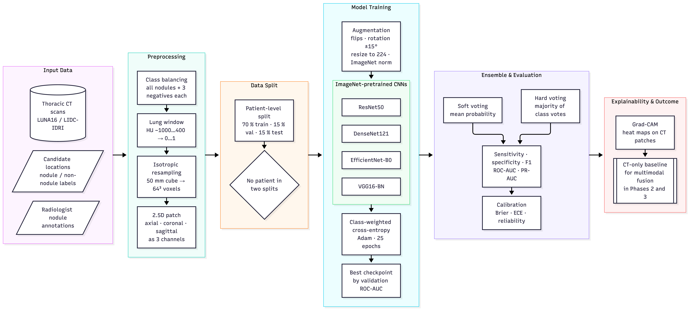
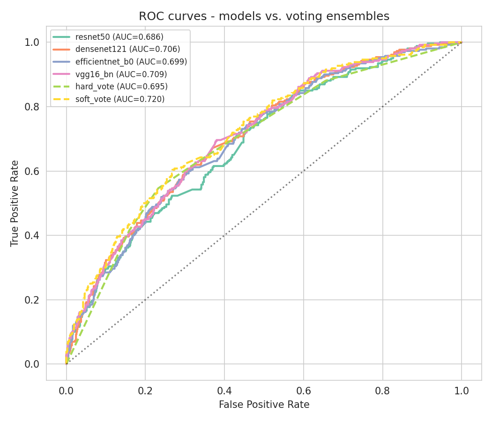
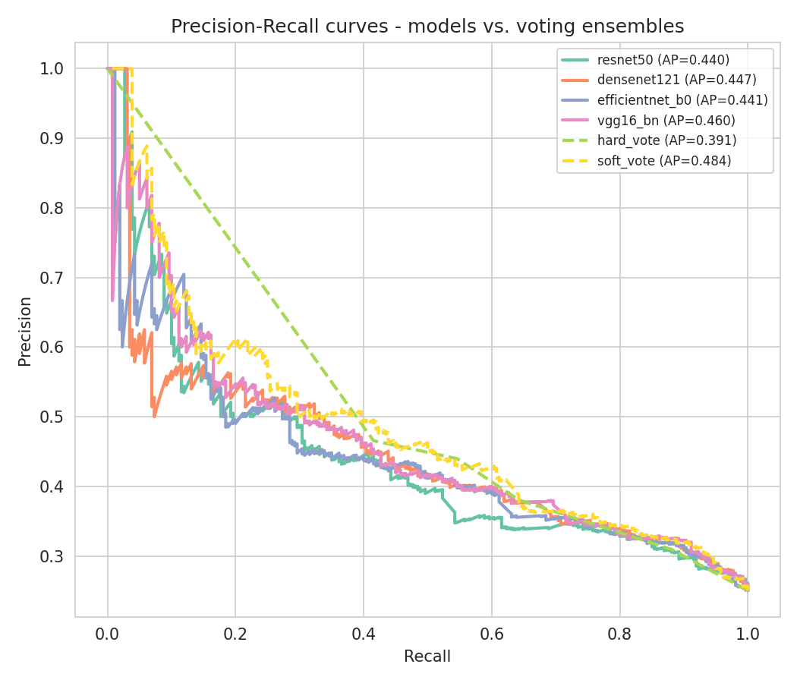
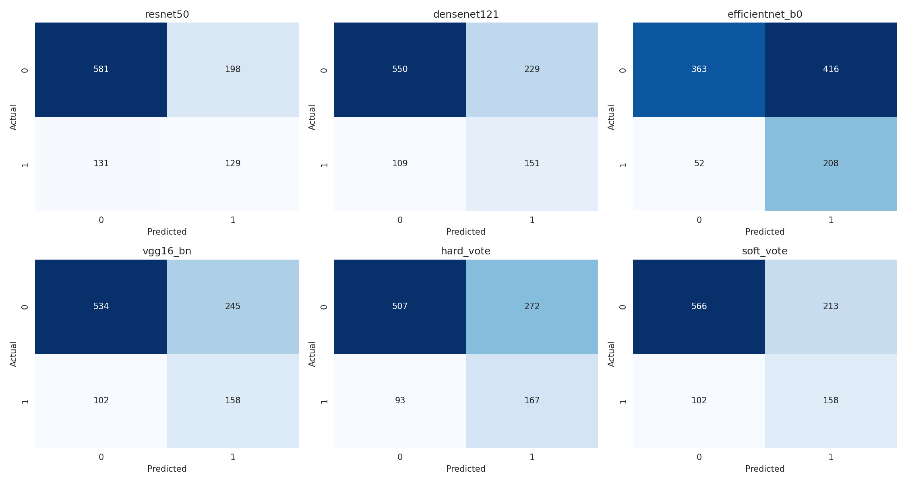
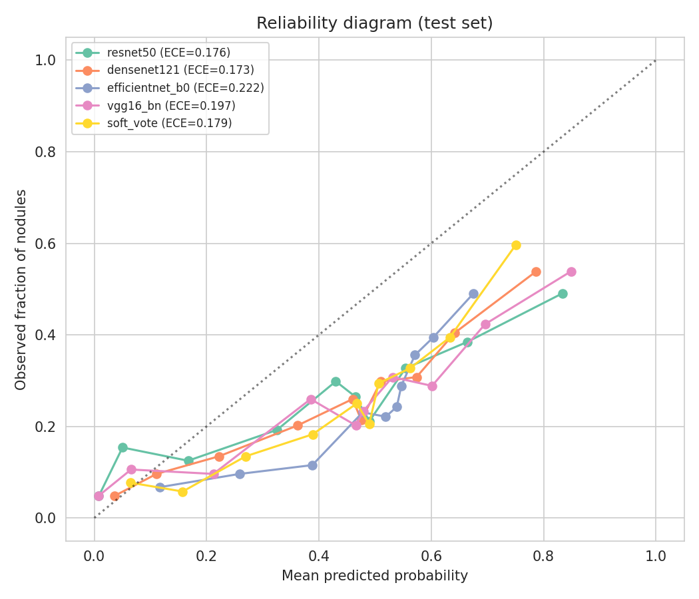
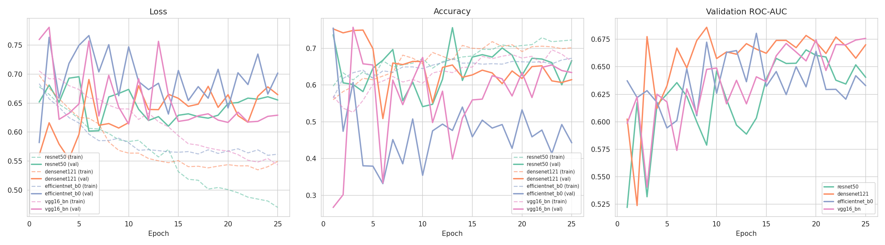
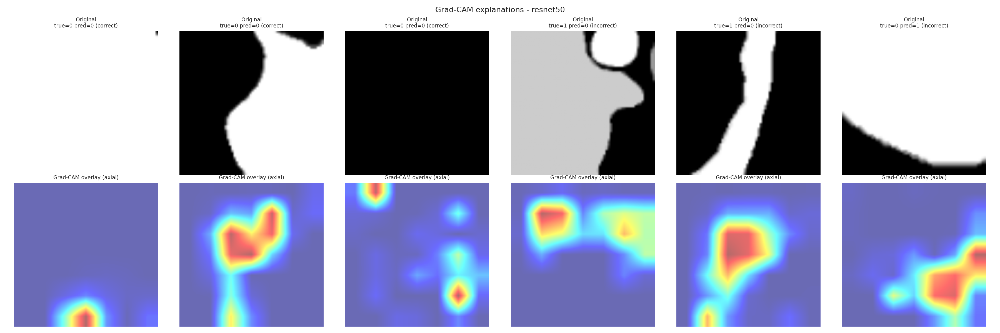

# Phase 1 — CT-only Baseline for Lung Nodule Classification (LUNA16)


Part of the research project **Multimodal Deep Learning for Lung Cancer Detection and Characterization**
(Research Project-I, Department of Computer Science and Engineering, NIT Rourkela, Autumn 2026–27).


Phase 1 builds the **CT-only reference model** that the later multimodal phases are compared against:


| Phase | Data | Goal |
|---|---|---|
| **1 (this repo)** | LUNA16 (CT) | CT-only baseline: nodule vs. non-nodule |
| 2 | LUNG-PET-CT-Dx (CT + PET + clinical) | early / intermediate / late / cross-attention fusion |
| 3 | NSCLC-Radiomics (CT + radiomics + clinical) | survival prognosis with radiomic and clinical fusion |


---


## Task


LUNA16 *false-positive reduction*: an automatic detector has already marked suspicious points
("candidates") in each scan. For every candidate the model decides


- **1 — nodule** (a nodule ≥ 3 mm marked by at least 3 of 4 radiologists), or
- **0 — not a nodule** (vessel, airway wall, other tissue).


The label is *nodule or not*, not benign vs. malignant.


## Method in short


1. **Balanced sampling** — all positive candidates plus 3 random negatives per positive.
2. **Lung window** — HU clipped to [−1000, 400] and scaled to [0, 1].
3. **Fixed physical size** — a 50 mm cube around each candidate is resampled to 64³ voxels
  (0.78 mm isotropic) using the scan geometry, so every patch covers the same area whatever the scanner.
4. **2.5D input** — the axial, coronal and sagittal planes through the candidate become the 3 channels of one image
  (Roth et al. 2014; Setio et al. 2016).
5. **Patient-level split** — 70 / 15 / 15 by scan, with a check that no scan is in two splits.
6. **Four ImageNet backbones** fine-tuned with identical settings: ResNet50, DenseNet121, EfficientNet-B0, VGG16-BN.
7. **Hard and soft voting ensembles** of the four models.
8. **Evaluation** — sensitivity, specificity, precision, F1, ROC-AUC, PR-AUC, Brier score, ECE; **Grad-CAM** heat maps.


## Architecture





Editable source of the diagram (Mermaid): [`architecture.mmd`](architecture.mmd).


## Results (held-out test scans, threshold 0.5)


| Model | Acc. | Sens. | Spec. | Prec. | F1 | ROC-AUC | PR-AUC | Brier ↓ | ECE ↓ |
|---|---|---|---|---|---|---|---|---|---|
| ResNet50 | 0.683 | 0.496 | **0.746** | 0.395 | 0.440 | 0.686 | 0.440 | 0.210 | 0.176 |
| DenseNet121 | 0.675 | 0.581 | 0.706 | 0.397 | 0.472 | 0.706 | 0.447 | 0.206 | **0.173** |
| EfficientNet-B0 | 0.550 | **0.800** | 0.466 | 0.333 | 0.471 | 0.699 | 0.441 | 0.223 | 0.222 |
| VGG16-BN | 0.666 | 0.608 | 0.686 | 0.392 | 0.477 | 0.709 | 0.460 | 0.215 | 0.197 |
| Hard voting | 0.649 | 0.642 | 0.651 | 0.380 | 0.478 | 0.695 | 0.391 | 0.258* | 0.227* |
| **Soft voting** | **0.697** | 0.608 | 0.727 | **0.426** | **0.501** | **0.720** | **0.484** | **0.202** | 0.179 |


\*Hard-vote scores are vote fractions (five possible values), so their Brier score and ECE are not directly comparable.
PR-AUC of a random classifier is about 0.25 (positive share).


**Summary.** The four backbones lie within about 0.02 ROC-AUC of each other; soft voting gives the best
overall result. The models use the 0.5 threshold differently (e.g. EfficientNet-B0 favours sensitivity,
ResNet50 favours specificity), so ROC-AUC and PR-AUC are the main comparison metrics.
Results are candidate-level on one patient-level split; the official LUNA16 benchmark reports FROC/CPM from
10-fold cross-validation, so the numbers are not directly comparable with the challenge leaderboard.


### Figures


| | |
|---|---|
| ROC curves |  |
| Precision–recall curves |  |
| Confusion matrices |  |
| Calibration |  |
| Training curves |  |
| Grad-CAM (ResNet50) |  |


All figures: [`figures/eda`](figures/eda), [`figures/per_model`](figures/per_model),
[`figures/comparison`](figures/comparison), [`figures/gradcam`](figures/gradcam).


## Repository structure


```
Phase 1 (CT-only Baseline)/
├── README.md
├── architecture.mmd                  # pipeline diagram (Mermaid)
├── kaggle_notebook/
│   └── phase1_luna16.py              # full notebook, cell by cell (# %% markers), as run on Kaggle
├── code/                             # the same pipeline split into one script per step
│   ├── config.py                     # paths and settings (override with LUNA16_INPUT / WORK_DIR)
│   ├── common.py                     # dataset, model builder, training/evaluation, ECE
│   ├── 01_preprocess.py              # candidates -> balanced 2.5D crops
│   ├── 02_split.py                   # patient-level 70/15/15 split + leakage check
│   ├── 03_eda.py                     # EDA figures
│   ├── 04_train.py                   # fine-tune the 4 backbones, test-set evaluation
│   ├── 05_compare_ensemble.py        # hard/soft voting + comparison figures and metrics table
│   ├── 06_gradcam.py                 # Grad-CAM heat maps
│   ├── 07_bundle_results.py          # zip figures + results
│   └── requirements.txt
├── model_results/                    # *_history.csv, *_test_predictions.csv, *_test_metrics.csv,
│                                     # ensemble_predictions.csv, final_metrics_all_models_and_ensembles.csv
└── figures/
   ├── flow_diagram.png              # architecture diagram
   ├── eda/                          # class balance, diameters, intensity histogram
   ├── per_model/                    # <model>_full_report.png
   ├── comparison/                   # ROC, PR, confusion matrices, calibration, bar chart, training curves
   └── gradcam/                      # <model>_gradcam.png
```


Model checkpoints (`*.pt`) are not included because of their size; they are recreated by `04_train.py`.


## How to run


### Option A — Kaggle notebook (as used for the reported results)


1. Create a Kaggle notebook, add a LUNA16 dataset that contains the `subset*` folders (`.mhd` / `.raw`)
  and `candidates_V2.csv` (or `candidates.csv`) plus `annotations.csv`.
2. Settings: **GPU on**, **Internet on** (ImageNet weights and `grad-cam` are downloaded).
3. Paste the cells of `kaggle_notebook/phase1_luna16.py` and use **Save Version → Save & Run All**.
4. Download `phase1_results_bundle.zip` from the notebook output.


### Option B — scripts


```bash
cd code
pip install -r requirements.txt
export LUNA16_INPUT=/path/to/luna16      # folder containing subset*/ and the CSV files
export WORK_DIR=./work                   # where crops, results and figures are written


python 01_preprocess.py
python 02_split.py
python 03_eda.py
python 04_train.py                       # or: python 04_train.py resnet50 vgg16_bn
python 05_compare_ensemble.py
python 06_gradcam.py
python 07_bundle_results.py
```


A GPU is strongly recommended for `04_train.py` (4 models × 25 epochs at 224 × 224).


## Reproducibility


- Fixed seed 42 for sampling, splitting and training; identical hyper-parameters for all backbones.
- The split is made by scan (`seriesuid`) and checked for leakage.
- GPU training is not bit-exact, so rerunning can change the last digit or two of the metrics.


## Data


Phase 1 uses the LUNA16 dataset. Please follow its terms of use:


- LUNA16 challenge: <https://luna16.grand-challenge.org/>


The data are not redistributed in this repository.


## References


- S. G. Armato III *et al.*, "The Lung Image Database Consortium (LIDC) and Image Database Resource Initiative (IDRI)," *Medical Physics*, 38(2), 2011.
- A. A. A. Setio *et al.*, "Validation, comparison, and combination of algorithms for automatic detection of pulmonary nodules in CT images: the LUNA16 challenge," *Medical Image Analysis*, 42, 2017.
- A. A. A. Setio *et al.*, "Pulmonary nodule detection in CT images: false positive reduction using multi-view convolutional networks," *IEEE TMI*, 35(5), 2016.
- H. R. Roth *et al.*, "A new 2.5D representation for lymph node detection using random sets of deep convolutional neural network observations," *MICCAI*, 2014.
- H.-C. Shin *et al.*, "Deep convolutional neural networks for computer-aided detection: CNN architectures, dataset characteristics and transfer learning," *IEEE TMI*, 35(5), 2016.
- N. Tajbakhsh *et al.*, "Convolutional neural networks for medical image analysis: full training or fine tuning?" *IEEE TMI*, 35(5), 2016.
- K. He *et al.*, "Deep residual learning for image recognition," *CVPR*, 2016.
- G. Huang *et al.*, "Densely connected convolutional networks," *CVPR*, 2017.
- M. Tan and Q. V. Le, "EfficientNet: rethinking model scaling for convolutional neural networks," *ICML*, 2019.
- K. Simonyan and A. Zisserman, "Very deep convolutional networks for large-scale image recognition," *ICLR*, 2015.
- C. Guo *et al.*, "On calibration of modern neural networks," *ICML*, 2017.
- R. R. Selvaraju *et al.*, "Grad-CAM: visual explanations from deep networks via gradient-based localization," *ICCV*, 2017.


## Author


**Ishita Rastogi** (123CS0212) — supervised by **Prof. Ratnakar Dash**,
Department of Computer Science and Engineering, National Institute of Technology Rourkela.
