# Multimodal Deep Learning for Lung Cancer Detection and Characterization


Research Project-I · Department of Computer Science and Engineering · National Institute of Technology Rourkela ·
Autumn Semester 2026–27


**Student:** Ishita Rastogi (123CS0212) · **Supervisor:** Prof. Ratnakar Dash
**Area:** Medical Image Analysis, Multimodal Deep Learning, Computer Vision, Explainable AI


> Research prototype. Not intended for clinical use.


---


## 1. Problem statement


Lung cancer diagnosis draws on several kinds of information:


- **CT** shows the anatomy: the shape, size and texture of nodules and tumours.
- **PET** shows metabolic activity: how strongly tissue takes up the tracer.
- **Clinical data** adds age, sex, smoking history and TNM stage.
- **Radiomic features** are numbers computed from the tumour region: shape, intensity and texture.


Most AI models for lung cancer use only one of these, usually CT. This project asks:


1. Does combining modalities improve lung-cancer detection and characterization compared with a CT-only model?
2. Which fusion strategy works best: early, intermediate (feature-level), late, or attention-based / cross-modal?
3. How robust are multimodal models when one modality is missing at test time?
4. What do the models rely on? (explainability)


Models are judged on sensitivity, specificity, F1, ROC-AUC, PR-AUC, calibration (Brier score, ECE), bootstrap 95%
confidence intervals and, for survival, C-index and Kaplan–Meier analysis. Accuracy alone is not used.


## 2. Approach at a glance


No public dataset provides CT, PET, clinical, radiomic and outcome data for the same patients. Following the research
plan, the work is therefore organised in three phases. Each phase uses the dataset that contains the modalities its
question needs. **All unimodal-versus-multimodal comparisons are made within one dataset**, on the same patients and
the same folds. Results are never compared across datasets.


| Phase | Dataset | Modalities | Task | Unit |
|---|---|---|---|---|
| **1 · CT-only baseline** | LUNA16 (from LIDC-IDRI) | CT | Nodule vs non-nodule candidate | candidate |
| **2 · CT + PET fusion** | LUNG-PET-CT-Dx | CT, PET, clinical | Adenocarcinoma vs other subtypes | patient |
| **3 · CT + radiomics + clinical** | NSCLC-Radiomics (Lung1) | CT, tumour contour, radiomics, clinical, survival | 2-year overall survival | patient |


### Overall system architecture


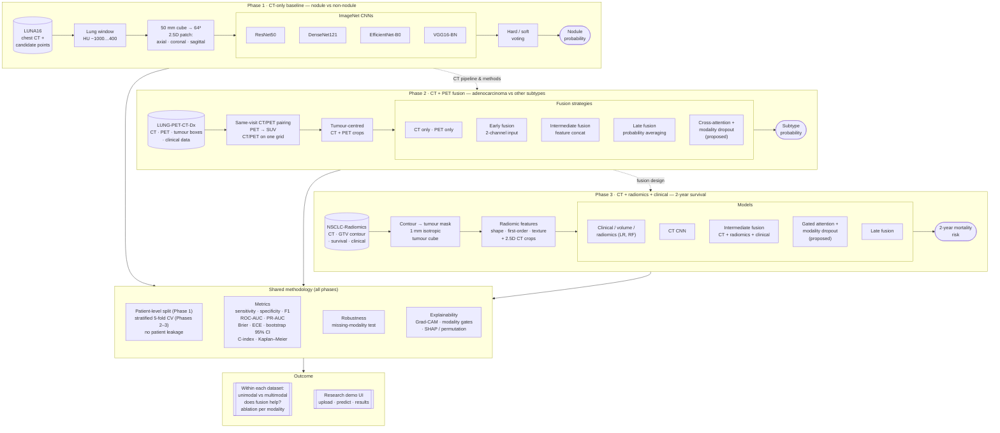


### Shared methodology (all phases)


- **Patient-level splitting.** No patient appears in both training and testing. Phase 1 uses one 70/15/15 split by
 scan; Phases 2–3 use stratified 5-fold cross-validation with a validation split inside each training fold.
- **Physically consistent preprocessing.** CT is lung-windowed (−1000 … 400 HU) and resampled to a fixed millimetre
 grid using the scan geometry. PET is converted to body-weight SUV and resampled onto the CT grid.
- **2.5D inputs.** Axial, coronal and sagittal planes through the lesion are stacked as 3 channels, so
 ImageNet-pretrained CNNs can be used.
- **Leakage-safe tabular pipelines.** Imputation, scaling and radiomic feature selection are fitted on training
 patients of each fold only.
- **Evaluation.** Sensitivity, specificity, precision, F1, ROC-AUC, PR-AUC, Brier score, ECE, reliability
 diagrams, patient-level bootstrap 95% CIs; for survival also C-index, Kaplan–Meier curves and log-rank tests.
- **Robustness.** Each fusion model is re-tested with one modality blanked out.
- **Explainability.** Grad-CAM heat maps, learned modality weights (gates), permutation importance and SHAP.


---


## 3. Phase 1 — CT-only baseline (LUNA16)


**Question.** How well can CT alone separate real nodules from false-positive candidates? Phase 1 builds and checks
the CT pipeline used later and gives a reference CT model.


**Data.** 888 thoracic CT scans; reference nodules are ≥ 3 mm and marked by at least 3 of 4 radiologists
(1,186 nodules). The candidate list (`candidates_V2.csv`) gives positions in millimetres and a 0/1 label.
The label means *nodule or not*, not benign vs malignant.


**Method.**
1. Keep all positive candidates plus 3 random negatives per positive (class balancing).
2. Lung window −1000 … 400 HU, scaled to 0 … 1 (Setio et al. 2016).
3. Resample a 50 mm cube around each candidate to 64³ voxels (0.78 mm isotropic).
4. Stack the central axial, coronal and sagittal planes as a 3 × 64 × 64 patch (2.5D; Roth et al. 2014).
5. Patient-level 70/15/15 split with a leakage check.
6. Fine-tune four ImageNet CNNs with identical settings: ResNet50, DenseNet121, EfficientNet-B0, VGG16-BN.
  Input upsampled to 224 px with ImageNet normalisation; class-weighted cross-entropy; Adam (lr 1e-4); 25 epochs;
  best checkpoint by validation ROC-AUC.
7. Hard and soft voting ensembles; Grad-CAM on the last convolutional block.


**Architecture.**


<details open>
<summary>Phase 1 pipeline</summary>


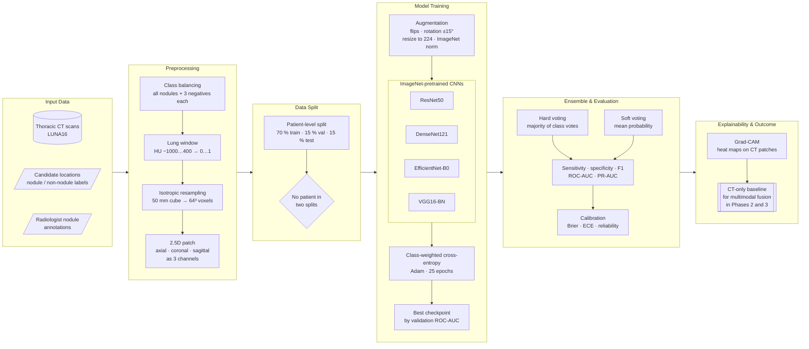


</details>


**Results (held-out test scans, threshold 0.5).**


| Model | Acc. | Sens. | Spec. | Prec. | F1 | ROC-AUC | PR-AUC | Brier ↓ | ECE ↓ |
|---|---|---|---|---|---|---|---|---|---|
| ResNet50 | 0.683 | 0.496 | **0.746** | 0.395 | 0.440 | 0.686 | 0.440 | 0.210 | 0.176 |
| DenseNet121 | 0.675 | 0.581 | 0.706 | 0.397 | 0.472 | 0.706 | 0.447 | 0.206 | **0.173** |
| EfficientNet-B0 | 0.550 | **0.800** | 0.466 | 0.333 | 0.471 | 0.699 | 0.441 | 0.223 | 0.222 |
| VGG16-BN | 0.666 | 0.608 | 0.686 | 0.392 | 0.477 | 0.709 | 0.460 | 0.215 | 0.197 |
| Hard voting | 0.649 | 0.642 | 0.651 | 0.380 | 0.478 | 0.695 | 0.391 | 0.258* | 0.227* |
| **Soft voting** | **0.697** | 0.608 | 0.727 | **0.426** | **0.501** | **0.720** | **0.484** | **0.202** | 0.179 |


\*Hard-vote scores are vote fractions (five values), so their Brier score and ECE are not directly comparable.
PR-AUC of a random classifier ≈ 0.25.


**Summary.** The four backbones lie within about 0.02 ROC-AUC of each other. Soft voting gives the best overall
result. Results are candidate-level on one split with sampled negatives, so they are not directly comparable with
the LUNA16 FROC/CPM leaderboard.


Details: [`phase1-ct-baseline/`](phase1-ct-baseline/).


---


## 4. Phase 2 — CT + PET fusion (LUNG-PET-CT-Dx)


**Question.** Does adding PET to CT improve histological subtype classification, and which fusion strategy works best?


**Data and cohort.** Patients with a CT and a PET from the same study, tumour bounding boxes and histology labels.
After checking that the annotated CT series belongs to the PET study (≥ 3 annotated slices located), the cohort is
**87 patients: 63 adenocarcinoma (label 0) and 24 other subtypes (label 1; 21 squamous, 3 small cell)**.
After DICOM conversion and crop extraction, **78 patients (59 / 19)** were used for modelling.


**Method.**
1. Pair CT and PET from the same study; use the CT series that carries the annotations.
2. Convert DICOM to CT (HU) and PET (body-weight SUV, decay-corrected; Kinahan & Fletcher 2010) volumes.
3. Resample CT and PET onto the same 160 mm / 128 px grid around the tumour box; up to 7 annotated slices per patient.
4. Simple tumour features (SUVmax/mean/std, HU mean/std, box size, z-extent) and clinical variables
  (sex, age, weight, smoking, T/N/M).
5. Models, all on the same stratified 5-fold patient-level CV:
  - tabular baselines: clinical, tumour features, both (logistic regression, random forest);
  - image baselines: CT only, PET only (ResNet-18);
  - early fusion (CT + PET as 2 channels), intermediate fusion (two encoders, concatenated features, optional
    clinical branch);
  - late fusion and soft/hard voting ensembles;
  - **proposed:** bidirectional cross-modal attention between CT and PET tokens with a learned modality gate, trained
    with **modality dropout** (Neverova et al. 2016), with and without clinical data.
6. Patient prediction = mean over slices. Missing-modality test, Grad-CAM, modality gates, SHAP.


**Architecture.**


<details open>
<summary>Phase 2 pipeline</summary>


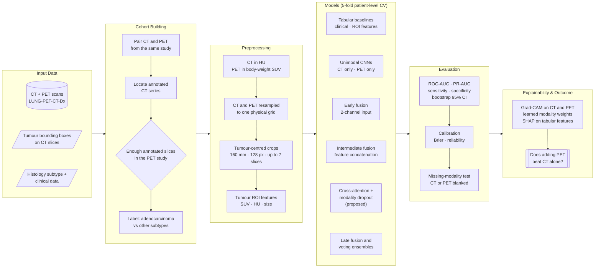


</details>


**Results (pooled out-of-fold, patient level).**


| Model | ROC-AUC [95% CI] | PR-AUC | Bal. acc. | Sens. | Spec. | Brier ↓ |
|---|---|---|---|---|---|---|
| Clinical (LR) | 0.747 [0.613, 0.868] | 0.504 | 0.723 | 0.684 | 0.763 | 0.193 |
| Tumour features (LR) | 0.787 [0.674, 0.884] | 0.492 | 0.724 | 0.737 | 0.712 | 0.183 |
| Clinical + tumour features (LR) | 0.825 [0.701, 0.937] | 0.586 | **0.802** | **0.789** | 0.814 | 0.148 |
| **Clinical + tumour features (RF)** | **0.841 [0.740, 0.933]** | **0.631** | 0.703 | 0.474 | 0.932 | **0.137** |
| CT only | 0.632 [0.486, 0.763] | 0.328 | 0.573 | 0.316 | 0.831 | 0.253 |
| PET only | 0.560 [0.388, 0.715] | 0.325 | 0.527 | 0.105 | **0.949** | 0.200 |
| Early fusion | 0.707 [0.590, 0.816] | 0.365 | 0.529 | 0.211 | 0.847 | 0.231 |
| Intermediate fusion | 0.617 [0.454, 0.764] | 0.351 | 0.519 | 0.105 | 0.932 | 0.217 |
| Intermediate + clinical | 0.702 [0.563, 0.837] | 0.445 | 0.545 | 0.158 | 0.932 | 0.189 |
| Cross-attention | 0.675 [0.536, 0.802] | 0.379 | 0.590 | 0.316 | 0.864 | 0.202 |
| **Cross-attention + modality dropout (proposed)** | 0.718 [0.571, 0.836] | 0.419 | 0.634 | 0.421 | 0.847 | 0.190 |
| Proposed + clinical | 0.715 [0.594, 0.835] | 0.471 | 0.592 | 0.421 | 0.763 | 0.205 |
| Late fusion (CT, PET) | 0.596 [0.436, 0.749] | 0.401 | 0.554 | 0.211 | 0.898 | 0.200 |
| Late fusion (CT, PET, clinical) | 0.678 [0.534, 0.812] | 0.473 | 0.563 | 0.211 | 0.915 | 0.171 |
| Soft vote (early, intermediate, proposed) | 0.721 [0.597, 0.824] | 0.388 | 0.546 | 0.211 | 0.881 | 0.197 |
| Hard vote (early, intermediate, proposed) | 0.626 [0.494, 0.751] | 0.312 | 0.546 | 0.211 | 0.881 | 0.229 |
| Soft vote (all image models) | 0.694 [0.561, 0.816] | 0.407 | 0.598 | 0.263 | 0.932 | 0.186 |
| Hard vote (all image models) | 0.621 [0.478, 0.766] | 0.374 | 0.607 | 0.316 | 0.898 | 0.205 |


78 patients (59 adenocarcinoma, 19 other subtypes); PR-AUC of a random model ≈ 0.24.


**Findings.**
- **Combining CT and PET beats either scan alone.** Every CT + PET image model is above the single-scan models:
 early fusion 0.707, the proposed model 0.718 and the soft vote 0.721, against CT only 0.632 and PET only 0.560.
- **Modality dropout helps the attention model.** It raises ROC-AUC from 0.675 to 0.718 and sensitivity from 0.32 to
 0.42.
- **Hand-crafted tumour features with clinical data work best.** SUV and HU statistics, tumour size, sex, age,
 smoking and stage reach 0.825 (logistic regression) and 0.841 (random forest). With 78 patients, simple models on a
 few strong features learn more reliably than CNNs trained from crops.
- **The confidence intervals are wide** (about ±0.13) and overlap, so differences between image models should be read
 as trends.


Details: [`phase2-ct-pet-fusion/`](phase2-ct-pet-fusion/).


---


## 5. Phase 3 — CT + radiomics + clinical survival model (NSCLC-Radiomics)


**Question.** Do radiomic and clinical data add value to a CT image model for predicting 2-year overall survival,
and is radiomics more informative than tumour volume alone?


**Data.** Planning CTs of NSCLC patients with the gross tumour volume (GTV-1) contour, clinical variables
(age, sex, T/N/M, overall stage, histology) and survival time with death status.
**Label:** 1 = died within 2 years, 0 = alive after 2 years. Patients censored before 2 years have no binary label
and are excluded from the classification task.


**Method.**
1. Pair each CT with its RTSTRUCT; rasterise the GTV-1 contour into a mask.
2. Resample a cube around the tumour to 1 mm isotropic voxels (IBSI-style; Zwanenburg et al. 2020).
3. Radiomic features with pyradiomics (shape, first-order, texture; van Griethuysen et al. 2017), or a built-in
  shape / first-order / GLCM set if pyradiomics is unavailable.
4. 2.5D CT crops (128 mm) through the tumour.
5. Models, all on the same stratified 5-fold patient-level CV:
  - tabular: clinical only, **tumour volume only** (checks whether radiomics is more than size; Welch et al. 2019),
    radiomics only, clinical + radiomics (early fusion), random forest;
  - CT CNN (ResNet-18);
  - intermediate fusion: CT + radiomics, CT + radiomics + clinical;
  - **proposed:** gated attention fusion of CT, radiomic and clinical embeddings, trained with modality dropout;
  - late fusion.
6. Radiomic feature selection (variance → correlation filter → top-k) fitted inside each training fold.
7. Evaluation adds C-index and Kaplan–Meier curves of predicted high- vs low-risk groups (log-rank test).


**Architecture.**


<details open>
<summary>Phase 3 pipeline</summary>


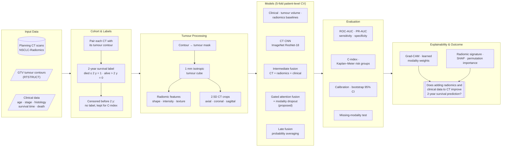


</details>


**Results (pooled out-of-fold, patient level).**


| Model | ROC-AUC [95% CI] | PR-AUC | C-index | Sens. | Spec. | Brier ↓ |
|---|---|---|---|---|---|---|
| Clinical (LR) | 0.541 [0.481, 0.595] | 0.629 | 0.533 | 0.521 | 0.552 | 0.253 |
| **Tumour volume (LR)** | 0.636 [0.581, 0.692] | **0.716** | **0.583** | 0.654 | 0.564 | 0.236 |
| Radiomics (LR) | 0.628 [0.572, 0.679] | 0.706 | 0.580 | 0.550 | **0.626** | 0.238 |
| Clinical + radiomics (LR) | 0.612 [0.557, 0.663] | 0.700 | 0.579 | 0.554 | 0.583 | 0.244 |
| **Clinical + radiomics (RF)** | **0.637 [0.580, 0.693]** | 0.696 | 0.580 | 0.700 | 0.466 | **0.231** |
| CT CNN | 0.586 [0.528, 0.644] | 0.667 | 0.553 | 0.713 | 0.454 | 0.259 |
| CT + radiomics | 0.544 [0.487, 0.602] | 0.635 | 0.527 | 0.638 | 0.411 | 0.276 |
| CT + radiomics + clinical | 0.561 [0.506, 0.620] | 0.641 | 0.541 | **0.750** | 0.344 | 0.248 |
| Gated fusion | 0.621 [0.566, 0.676] | 0.688 | 0.576 | 0.696 | 0.528 | 0.242 |
| Gated fusion + modality dropout (proposed) | 0.600 [0.543, 0.658] | 0.675 | 0.562 | 0.721 | 0.417 | 0.247 |
| Late fusion (CT, radiomics) | 0.614 [0.559, 0.673] | 0.688 | 0.572 | 0.700 | 0.460 | 0.237 |
| Late fusion (CT, radiomics, clinical) | 0.616 [0.559, 0.677] | 0.687 | 0.577 | 0.721 | 0.466 | 0.235 |


403 patients (240 died within 2 years, 163 alive after 2 years); PR-AUC of a random model ≈ 0.60.


**Findings.**
- **Two-year survival is hard to predict from these inputs.** The best models reach ROC-AUC of about 0.63–0.64 and a
 C-index of about 0.58, in line with the moderate values reported for this cohort in earlier radiomics work.
- **Tumour volume alone is as informative as the full radiomic signature** (0.636 vs 0.628). This matches the warning
 of Welch et al. (2019) that radiomic signatures often mostly measure tumour size.
- **Weighting sources helps more than joining them.** Among the deep models, gated fusion (0.621) is clearly above
 simple concatenation (0.544–0.561) and the CT CNN (0.586). Late fusion of CT with radiomics and clinical data is
 similar (0.616).
- **Clinical variables alone add little** (0.541). Modality dropout did not raise accuracy in this phase
 (0.600 vs 0.621); its value is robustness when a source is missing.


Details: [`phase3-radiomics-survival/`](phase3-radiomics-survival/).


---


## 6. Proposed fusion model


The same design is used in Phase 2 (CT + PET, with an optional clinical branch) and Phase 3 (CT + radiomics +
clinical). Each source has its own encoder. In Phase 2, CT and PET feature maps first attend to each other.
A small gate then learns, for every patient, how much weight each source gets, and the weighted features go to the
classifier. During training one source is blanked at random (**modality dropout**), so the model still works when a
source is missing. The gate weights also show how much the model relied on each source.


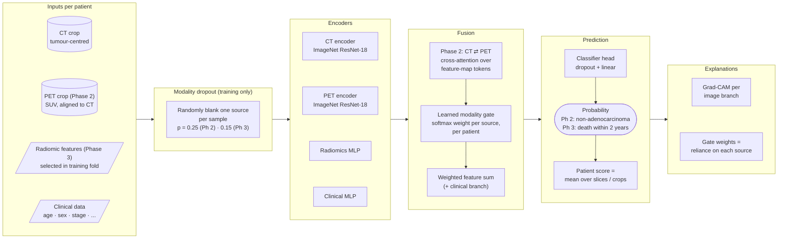


Source: [`proposed_model.mmd`](proposed_model.mmd).


## 7. Demonstration gallery


<table>
<tr>
<th></th><th>Input</th><th>Performance</th><th>Explanation</th>
</tr>
<tr>
<th>Phase 1<br/>CT only</th>
<td>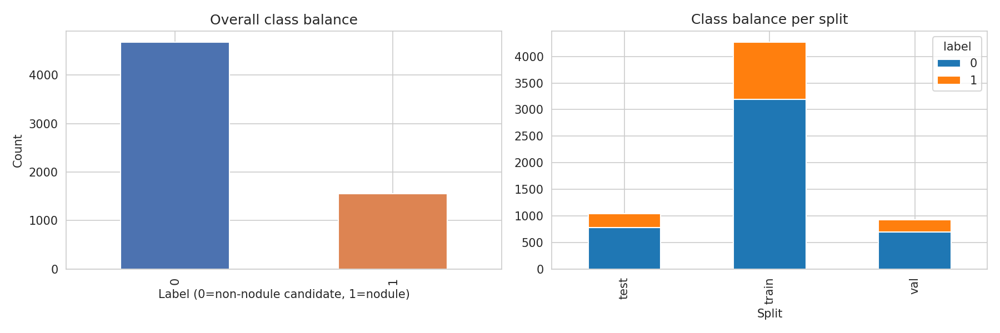<br/><sub>Class balance after sampling: all nodules plus 3 non-nodules each, split by patient.</sub></td>
<td>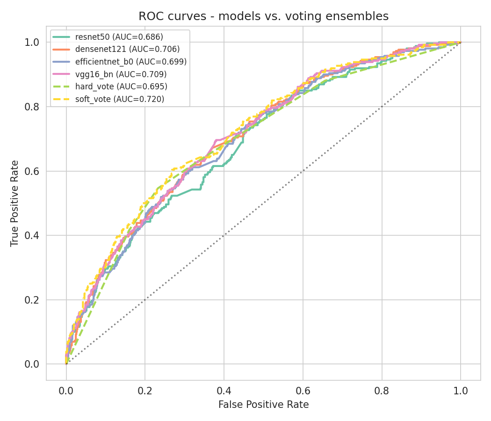<br/><sub>ROC curves of the four CNNs and the voting ensembles; soft voting is best (AUC 0.720).</sub></td>
<td>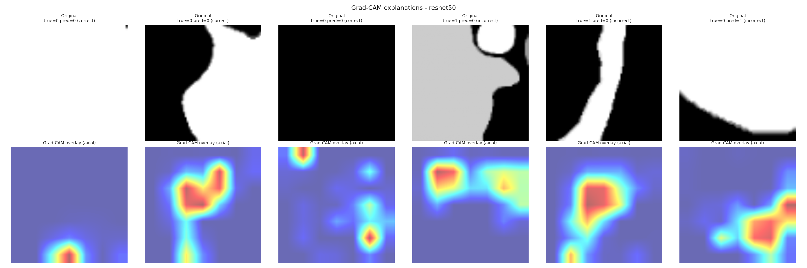<br/><sub>Grad-CAM: where ResNet50 looked when calling a candidate a nodule or not.</sub></td>
</tr>
<tr>
<th>Phase 2<br/>CT + PET</th>
<td>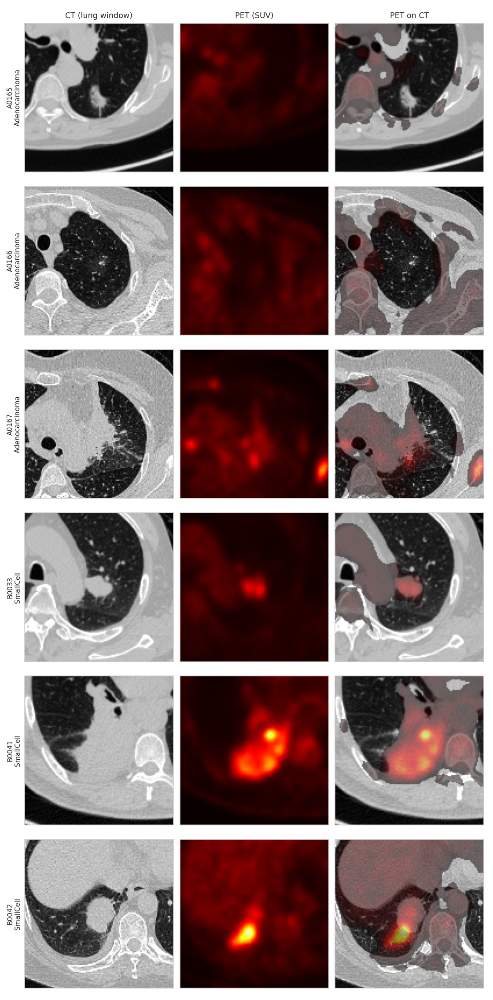<br/><sub>Aligned tumour crops: CT, PET (SUV) and PET over CT for each subtype group.</sub></td>
<td>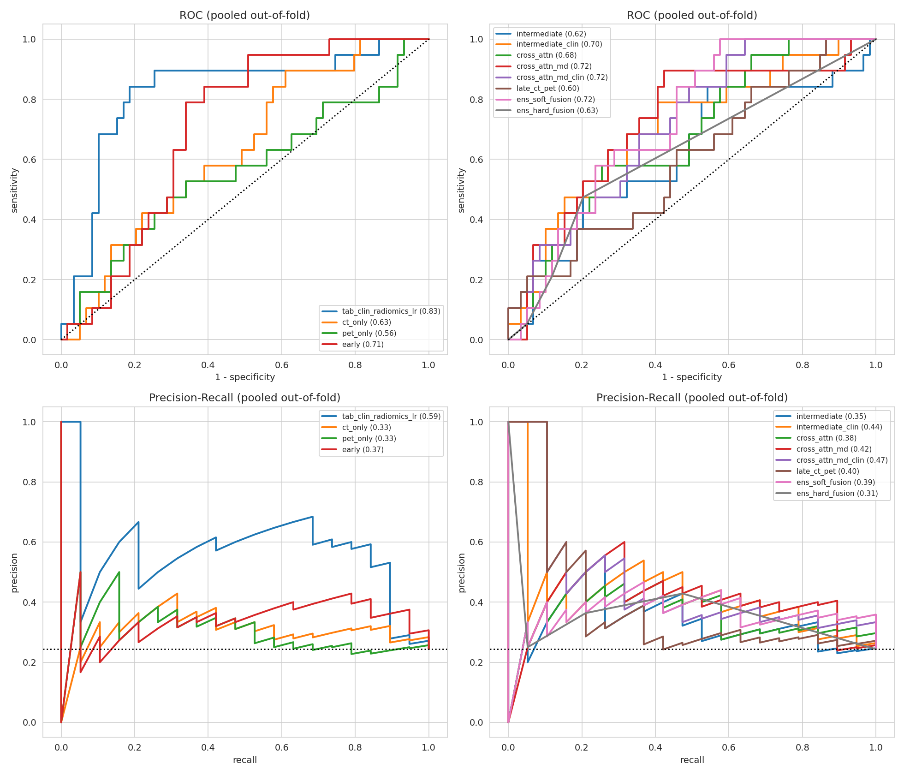<br/><sub>ROC and precision-recall curves of single-scan, fusion and ensemble models (5-fold CV).</sub></td>
<td>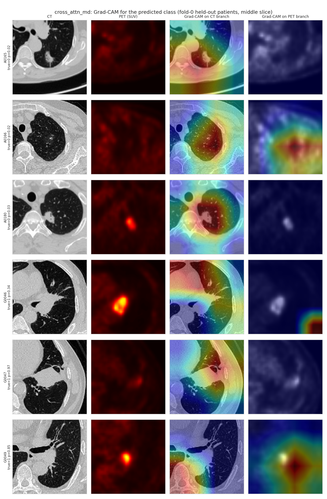<br/><sub>Grad-CAM of the proposed model on its CT and PET branches.</sub></td>
</tr>
<tr>
<th>Phase 3<br/>CT + radiomics + clinical</th>
<td>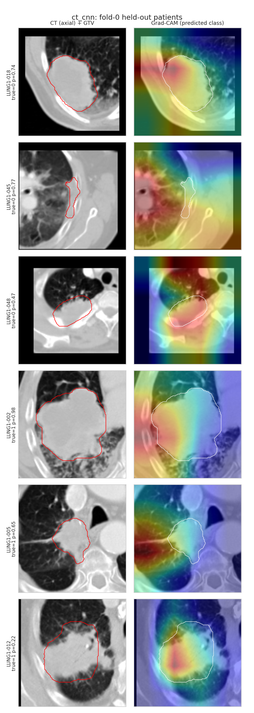<br/><sub>2.5D CT crops with the tumour outline (red) for survivors and non-survivors.</sub></td>
<td>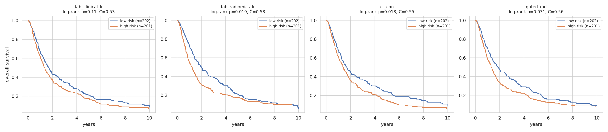<br/><sub>Kaplan-Meier curves of predicted high- vs low-risk patients, with log-rank p and C-index.</sub></td>
<td>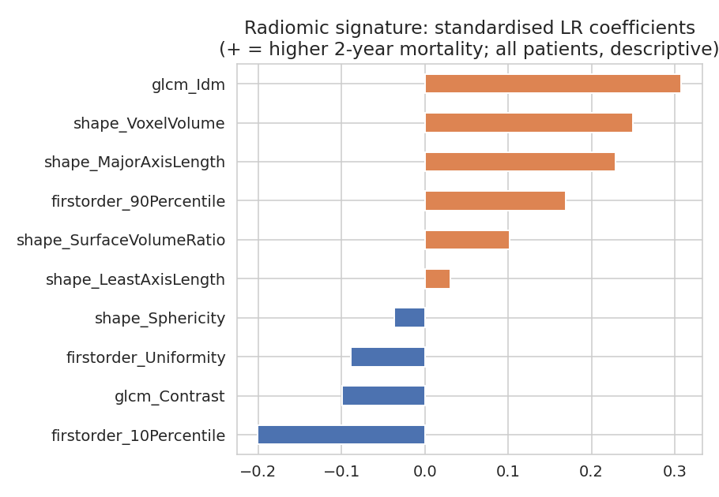<br/><sub>Radiomic signature: features linked to higher or lower 2-year mortality.</sub></td>
</tr>
</table>


The interactive version of these results, including uploading a CT scan for Phase 1, is in
[`streamlit_ui/`](streamlit_ui/).


## 8. What the project delivers


1. A **CT-only baseline** with a documented, leakage-safe pipeline (Phase 1).
2. A **controlled comparison of fusion strategies** (early, intermediate, late, attention-based) for CT + PET
  (Phase 2) and CT + radiomics + clinical (Phase 3), each against its own unimodal baselines.
3. A **proposed fusion model** (attention / gated fusion with modality dropout) with ablations showing the
  contribution of each modality and component.
4. **Missing-modality robustness** results.
5. **Explainability** outputs: Grad-CAM, learned modality weights, permutation importance, SHAP.
6. **Reproducible code** (Kaggle notebooks and step-by-step scripts) and a **Streamlit demo** to upload a CT,
  view slices, run the Phase 1 models with Grad-CAM, and browse all results.


## 9. Repository structure


```
.
├── README.md                         # this file
├── system_architecture.mmd           # overall architecture (Mermaid)
├── proposed_model.mmd                # proposed fusion model (Mermaid)
├── phase1-ct-baseline/               # Phase 1: notebook, scripts, README, figures, results
├── phase2-ct-pet-fusion/             # Phase 2: notebook, scripts, README
├── phase3-radiomics-survival/        # Phase 3: notebook, scripts, README
├── compare_phases.py                 # Phase 2 fusion-vs-CT paired bootstrap + per-phase summary table
├── streamlit_ui/                     # research demo app
└── report/                           # LaTeX reports
```


No patient data, model weights or intermediate volumes are stored in this repository.


## 10. How to run


Each phase runs as one Kaggle notebook (GPU and Internet on). Use **Save Version → Save & Run All** so long runs
continue after the browser is closed, then download the results bundle from the notebook output.


| Phase | Attach on Kaggle | Notebook | Output |
|---|---|---|---|
| 1 | LUNA16 (with `subset*` folders, `candidates_V2.csv`, `annotations.csv`) | `phase1-ct-baseline/kaggle_notebook/phase1_luna16.py` | `phase1_results_bundle.zip` |
| 2 | [`rangan2510/lung-pet-ct-dx`](https://www.kaggle.com/datasets/rangan2510/lung-pet-ct-dx) | `phase2-ct-pet-fusion/kaggle_notebook/phase2.py` | `phase2_results_bundle.zip` |
| 3 | [`umutkrdrms/nsclc-radiomics`](https://www.kaggle.com/datasets/umutkrdrms/nsclc-radiomics) + Lung1 clinical CSV | `phase3-radiomics-survival/kaggle_notebook/phase3.py` | `phase3_results_bundle.zip` |


Each phase folder also has a `code/` directory with the same pipeline split into numbered scripts, and its own
README with details.


Local comparison and demo:


```bash
python compare_phases.py --p1 phase1_results_bundle --p2 phase2_results_bundle --out comparison
cd streamlit_ui && pip install -r requirements.txt && streamlit run app.py
```


## 11. Datasets


| Dataset | Source | Citation |
|---|---|---|
| LUNA16 | <https://luna16.grand-challenge.org/> | Setio et al. 2017; Armato et al. 2011 (LIDC-IDRI) |
| LUNG-PET-CT-Dx | <https://www.cancerimagingarchive.net/collection/lung-pet-ct-dx/> | Li et al. 2020 |
| NSCLC-Radiomics (Lung1) | <https://www.cancerimagingarchive.net/collection/nsclc-radiomics/> | Aerts et al. 2014 |


Please follow each dataset's terms of use.


## 12. Limitations


- Each phase uses a different public dataset, so results are compared within a dataset, not across phases.
- Phase 1 reports candidate-level metrics on one split, not the LUNA16 FROC/CPM protocol.
- Phase 2 has a small cohort (78 patients after preprocessing); confidence intervals are wide.
- Phase 3 excludes patients censored before 2 years from the binary task.
- No external validation set; all results are internal.


## 13. References


- S. G. Armato III *et al.*, "The Lung Image Database Consortium (LIDC) and Image Database Resource Initiative (IDRI)," *Medical Physics*, 38(2), 2011.
- A. A. A. Setio *et al.*, "Validation, comparison, and combination of algorithms for automatic detection of pulmonary nodules in CT images: the LUNA16 challenge," *Medical Image Analysis*, 42, 2017.
- A. A. A. Setio *et al.*, "Pulmonary nodule detection in CT images: false positive reduction using multi-view convolutional networks," *IEEE TMI*, 35(5), 2016.
- H. R. Roth *et al.*, "A new 2.5D representation for lymph node detection using random sets of deep convolutional neural network observations," *MICCAI*, 2014.
- P. Li *et al.*, "A large-scale CT and PET/CT dataset for lung cancer diagnosis (Lung-PET-CT-Dx)," The Cancer Imaging Archive, 2020.
- H. J. W. L. Aerts *et al.*, "Decoding tumour phenotype by noninvasive imaging using a quantitative radiomics approach," *Nature Communications*, 5, 2014.
- A. Hosny *et al.*, "Deep learning for lung cancer prognostication: a retrospective multi-cohort radiomics study," *PLoS Medicine*, 15(11), 2018.
- M. L. Welch *et al.*, "Vulnerabilities of radiomic signature development: the need for safeguards," *Radiotherapy and Oncology*, 130, 2019.
- J. J. M. van Griethuysen *et al.*, "Computational radiomics system to decode the radiographic phenotype," *Cancer Research*, 77(21), 2017.
- A. Zwanenburg *et al.*, "The Image Biomarker Standardization Initiative," *Radiology*, 295(2), 2020.
- P. E. Kinahan and J. W. Fletcher, "PET/CT standardized uptake values in clinical practice and assessing response to therapy," *Seminars in Ultrasound, CT and MRI*, 31(6), 2010.
- S.-C. Huang *et al.*, "Fusion of medical imaging and electronic health records using deep learning: a systematic review," *npj Digital Medicine*, 3, 2020.
- N. Neverova *et al.*, "ModDrop: adaptive multi-modal gesture recognition," *IEEE TPAMI*, 38(8), 2016.
- A. Vaswani *et al.*, "Attention is all you need," *NeurIPS*, 2017.
- H.-C. Shin *et al.*, "Deep convolutional neural networks for computer-aided detection," *IEEE TMI*, 35(5), 2016.
- N. Tajbakhsh *et al.*, "Convolutional neural networks for medical image analysis: full training or fine tuning?" *IEEE TMI*, 35(5), 2016.
- K. He *et al.*, "Deep residual learning for image recognition," *CVPR*, 2016.
- G. Huang *et al.*, "Densely connected convolutional networks," *CVPR*, 2017.
- M. Tan and Q. V. Le, "EfficientNet," *ICML*, 2019.
- K. Simonyan and A. Zisserman, "Very deep convolutional networks for large-scale image recognition," *ICLR*, 2015.
- E. Yagis *et al.*, "Effect of data leakage in brain MRI classification using 2D convolutional neural networks," *Scientific Reports*, 11, 2021.
- T. Saito and M. Rehmsmeier, "The precision-recall plot is more informative than the ROC plot when evaluating binary classifiers on imbalanced datasets," *PLoS ONE*, 10(3), 2015.
- C. Guo *et al.*, "On calibration of modern neural networks," *ICML*, 2017.
- F. E. Harrell *et al.*, "Evaluating the yield of medical tests," *JAMA*, 247(18), 1982.
- E. L. Kaplan and P. Meier, "Nonparametric estimation from incomplete observations," *JASA*, 53(282), 1958.
- R. R. Selvaraju *et al.*, "Grad-CAM: visual explanations from deep networks via gradient-based localization," *ICCV*, 2017.
- S. M. Lundberg and S.-I. Lee, "A unified approach to interpreting model predictions," *NeurIPS*, 2017.