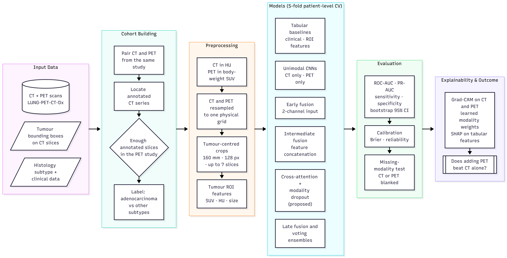

# Phase 2 — CT + PET Fusion for Lung Cancer Subtype Classification (LUNG-PET-CT-Dx)


Part of the research project **Multimodal Deep Learning for Lung Cancer Detection and Characterization**
(Research Project-I, Department of Computer Science and Engineering, NIT Rourkela, Autumn 2026–27).


| Phase | Data | Goal |
|---|---|---|
| 1 | LUNA16 (CT) | CT-only baseline: nodule vs. non-nodule |
| **2 (this repo)** | LUNG-PET-CT-Dx (CT + PET + clinical) | early / intermediate / late / cross-attention fusion |
| 3 | NSCLC-Radiomics (CT + radiomics + clinical) | 2-year survival with radiomic and clinical fusion |


---


## Task


Patient-level histology classification from tumour-centred CT and PET crops (plus optional clinical data):


- **0 — adenocarcinoma**
- **1 — other subtype** (squamous cell, small cell, large cell)


(`TASK = "adeno_vs_squamous"` in `code/config.py` switches to adenocarcinoma vs. squamous only.)
The main question is whether adding PET to CT improves on CT alone, and which fusion strategy works best.
All comparisons are made within this dataset, on the same patients and folds.


## Method in short


1. **Cohort** — patients with a CT and a PET in the **same study**. The CT series holding the tumour annotations is
  found by matching annotation file names (SOP Instance UIDs) to CT slice headers. A patient is used if at least
  3 annotated slices are found in a CT of the PET study.
2. **CT and PET values** — CT in Hounsfield units; PET converted to **body-weight SUV** from the DICOM dose, decay and
  patient-weight fields (Kinahan & Fletcher 2010).
3. **Alignment** — CT and PET are resampled onto one physical grid around each tumour box:
  160 mm field of view, 128 × 128 px, up to 7 annotated slices per patient. CT uses the lung window
  (−1000…400 HU → 0…1), PET is clipped at SUV 15.
4. **Tumour ROI features** — SUV max/mean/std, HU mean/std, box size and tumour z-extent.
5. **Models** (ImageNet ResNet-18 encoders, He et al. 2016), trained with **5-fold patient-level cross-validation**:
  - tabular baselines on clinical and ROI features (logistic regression, random forest)
  - CT only, PET only
  - **early fusion** (CT + PET as 2 channels), **intermediate fusion** (separate encoders, concatenated features,
    optionally + clinical), **late fusion** (averaged probabilities) — taxonomy of Huang et al. 2020
  - **cross-modal attention** (CT tokens attend to PET tokens and vice versa, Vaswani et al. 2017) with a learned
    modality gate, and the **proposed** variant with **modality dropout** (Neverova et al. 2016)
  - soft and hard voting ensembles with fixed, pre-declared members
6. **Evaluation** — pooled out-of-fold patient predictions: ROC-AUC, PR-AUC (Saito & Rehmsmeier 2015), sensitivity,
  specificity, F1, Brier score and calibration (Guo et al. 2017), with **patient-bootstrap 95% confidence intervals**.
7. **Missing-modality test** — the same trained fusion models with CT or PET blanked at test time.
8. **Explainability** — Grad-CAM on the CT and PET branches (Selvaraju et al. 2017), the learned modality weights,
  and permutation / SHAP importance of the tabular features (Lundberg & Lee 2017).


## Architecture





Editable source of the diagram (Mermaid): [`architecture.mmd`](architecture.mmd).


## Results (pooled out-of-fold, patient level, threshold 0.5)


| Model | ROC-AUC [95% CI] | PR-AUC | Bal. acc. | Sens. | Spec. | Brier ↓ |
|---|---|---|---|---|---|---|
| Clinical (LR) | 0.747 [0.613, 0.868] | 0.504 | 0.723 | 0.684 | 0.763 | 0.193 |
| Tumour features (LR) | 0.787 [0.674, 0.884] | 0.492 | 0.724 | 0.737 | 0.712 | 0.183 |
| Clinical + tumour features (LR) | 0.825 [0.701, 0.937] | 0.586 | **0.802** | **0.789** | 0.814 | 0.148 |
| **Clinical + tumour features (RF)** | **0.841 [0.740, 0.933]** | **0.631** | 0.703 | 0.474 | 0.932 | **0.137** |
| CT only | 0.632 [0.486, 0.763] | 0.328 | 0.573 | 0.316 | 0.831 | 0.253 |
| PET only | 0.560 [0.388, 0.715] | 0.325 | 0.527 | 0.105 | **0.949** | 0.200 |
| Early fusion | 0.707 [0.590, 0.816] | 0.365 | 0.529 | 0.211 | 0.847 | 0.231 |
| Intermediate fusion | 0.617 [0.454, 0.764] | 0.351 | 0.519 | 0.105 | 0.932 | 0.217 |
| Intermediate + clinical | 0.702 [0.563, 0.837] | 0.445 | 0.545 | 0.158 | 0.932 | 0.189 |
| Cross-attention | 0.675 [0.536, 0.802] | 0.379 | 0.590 | 0.316 | 0.864 | 0.202 |
| **Cross-attention + modality dropout (proposed)** | 0.718 [0.571, 0.836] | 0.419 | 0.634 | 0.421 | 0.847 | 0.190 |
| Proposed + clinical | 0.715 [0.594, 0.835] | 0.471 | 0.592 | 0.421 | 0.763 | 0.205 |
| Late fusion (CT, PET) | 0.596 [0.436, 0.749] | 0.401 | 0.554 | 0.211 | 0.898 | 0.200 |
| Late fusion (CT, PET, clinical) | 0.678 [0.534, 0.812] | 0.473 | 0.563 | 0.211 | 0.915 | 0.171 |
| Soft vote (early, intermediate, proposed) | 0.721 [0.597, 0.824] | 0.388 | 0.546 | 0.211 | 0.881 | 0.197 |
| Hard vote (early, intermediate, proposed) | 0.626 [0.494, 0.751] | 0.312 | 0.546 | 0.211 | 0.881 | 0.229 |
| Soft vote (all image models) | 0.694 [0.561, 0.816] | 0.407 | 0.598 | 0.263 | 0.932 | 0.186 |
| Hard vote (all image models) | 0.621 [0.478, 0.766] | 0.374 | 0.607 | 0.316 | 0.898 | 0.205 |


78 patients (59 adenocarcinoma, 19 other subtypes); PR-AUC of a random model ≈ 0.24.


**Findings.**
- **Combining CT and PET beats either scan alone.** Every CT + PET image model is above the single-scan models:
 early fusion 0.707, the proposed model 0.718 and the soft vote 0.721, against CT only 0.632 and PET only 0.560.
- **Modality dropout helps the attention model.** It raises ROC-AUC from 0.675 to 0.718 and sensitivity from 0.32 to
 0.42.
- **Hand-crafted tumour features with clinical data work best.** SUV and HU statistics, tumour size, sex, age,
 smoking and stage reach 0.825 (logistic regression) and 0.841 (random forest). With 78 patients, simple models on a
 few strong features learn more reliably than CNNs trained from crops.
- **The confidence intervals are wide** (about ±0.13) and overlap, so differences between image models should be read
 as trends.


The missing-modality results are in `phase2_results/results_missing_modality.csv`. Figures are in
[`figures/`](figures) (`eda*`, `eval*`, `explain_*`).


## Repository structure


```
Phase 2 (CT + PET Fusion)/
├── README.md
├── architecture.mmd                  # pipeline diagram (Mermaid)
├── kaggle_notebook/
│   └── phase2.py                     # full notebook, cell by cell (# %% markers), as run on Kaggle
├── code/                             # the same pipeline split into one script per step
│   ├── config.py                     # paths and settings (override with INPUT_DIR / WORK_DIR)
│   ├── common.py                     # tables, annotations, DICOM/SUV, crops, metrics, state loading (no torch)
│   ├── models.py                     # networks, slice dataset, training / prediction, Grad-CAM
│   ├── 01_build_cohort.py            # CT/PET pairing, annotation check, fusion rule, labels, EDA 1-2
│   ├── 02_dicom_to_volumes.py        # CT (HU) + PET (SUV) NIfTI volumes, resumable, parallel
│   ├── 03_extract_crops.py           # aligned tumour crops + ROI features
│   ├── 04_eda_crops.py               # crop montage, feature box plots, correlation
│   ├── 05_tabular_baselines.py       # CV folds + clinical / ROI-feature baselines
│   ├── 06_train.py                   # all image models with 5-fold CV (or: python 06_train.py ct_only cross_attn_md)
│   ├── 07_ensembles.py               # late fusion and voting ensembles
│   ├── 08_evaluate.py                # results table with 95% CIs + evaluation figures
│   ├── 09_missing_modality.py        # CT or PET blanked at test time
│   ├── 10_explain.py                 # Grad-CAM, modality gate, permutation / SHAP importance
│   ├── 11_bundle_results.py          # run summary + zip
│   └── requirements.txt
├── phase2_results/                   # oof_*.csv, history_*.csv, results_*.csv, run_summary.json
└── figures/                          # flow_diagram.png, eda*, eval*, explain_*
```


Not included: the dataset, the converted volumes and crops (several GB, regenerated by steps 2–3) and model weights.


## How to run


### Option A — Kaggle notebook


1. Create a Kaggle notebook and add the dataset
  [`rangan2510/lung-pet-ct-dx`](https://www.kaggle.com/datasets/rangan2510/lung-pet-ct-dx).
2. Settings: **GPU on**, **Internet on** (ImageNet weights).
3. Paste the cells of `kaggle_notebook/phase2.py` and use **Save Version → Save & Run All**.
4. Download `phase2_results_bundle.zip` from the notebook output.


### Option B — scripts


```bash
cd code
pip install -r requirements.txt
export INPUT_DIR=/path/to/inputs      # folder containing the LUNG-PET-CT-Dx dataset
export WORK_DIR=./work                # where results, volumes, crops and figures are written


python 01_build_cohort.py
python 02_dicom_to_volumes.py
python 03_extract_crops.py
python 04_eda_crops.py
python 05_tabular_baselines.py
python 06_train.py
python 07_ensembles.py
python 08_evaluate.py
python 09_missing_modality.py
python 10_explain.py
python 11_bundle_results.py
```


Each script reads what the earlier ones wrote, so a step can be rerun on its own. `QUICK_TEST = True` in
`config.py` runs a small check (24 patients, 2 folds, 2 epochs).


## Reproducibility


- Fixed seed 42 for sampling, folds, validation splits and training.
- Folds are made by patient (stratified 5-fold); clinical imputation and scaling are fitted on training patients only.
- Ensembles use fixed members, so no model selection is done on the test predictions.
- GPU training is not bit-exact, so rerunning can change the last digit or two of the metrics.


## Data


- Kaggle mirror: <https://www.kaggle.com/datasets/rangan2510/lung-pet-ct-dx>
- Original collection (TCIA): <https://www.cancerimagingarchive.net/collection/lung-pet-ct-dx/>


Please follow the TCIA data usage policy and cite the dataset. The data are not redistributed here.


## References


- P. Li *et al.*, "A large-scale CT and PET/CT dataset for lung cancer diagnosis (Lung-PET-CT-Dx)," *The Cancer Imaging Archive*, 2020.
- S.-C. Huang *et al.*, "Fusion of medical imaging and electronic health records using deep learning: a systematic review and implementation guidelines," *npj Digital Medicine*, 3, 2020.
- N. Neverova *et al.*, "ModDrop: adaptive multi-modal gesture recognition," *IEEE TPAMI*, 38(8), 2016.
- A. Vaswani *et al.*, "Attention is all you need," *NeurIPS*, 2017.
- P. E. Kinahan and J. W. Fletcher, "PET/CT standardized uptake values in clinical practice and assessing response to therapy," *Seminars in Ultrasound, CT and MRI*, 31(6), 2010.
- K. He *et al.*, "Deep residual learning for image recognition," *CVPR*, 2016.
- R. R. Selvaraju *et al.*, "Grad-CAM: visual explanations from deep networks via gradient-based localization," *ICCV*, 2017.
- C. Guo *et al.*, "On calibration of modern neural networks," *ICML*, 2017.
- T. Saito and M. Rehmsmeier, "The precision-recall plot is more informative than the ROC plot when evaluating binary classifiers on imbalanced datasets," *PLoS ONE*, 10(3), 2015.
- S. M. Lundberg and S.-I. Lee, "A unified approach to interpreting model predictions," *NeurIPS*, 2017.


## Author


**Ishita Rastogi** (123CS0212) — supervised by **Prof. Ratnakar Dash**,
Department of Computer Science and Engineering, National Institute of Technology Rourkela.