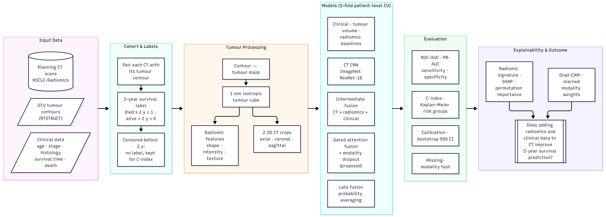

# Phase 3 — CT + Radiomics + Clinical Data for 2-Year Survival (NSCLC-Radiomics)


Part of the research project **Multimodal Deep Learning for Lung Cancer Detection and Characterization**
(Research Project-I, Department of Computer Science and Engineering, NIT Rourkela, Autumn 2026–27).


| Phase | Data | Goal |
|---|---|---|
| 1 | LUNA16 (CT) | CT-only baseline: nodule vs. non-nodule |
| 2 | LUNG-PET-CT-Dx (CT + PET + clinical) | CT/PET fusion for histology subtype |
| **3 (this repo)** | NSCLC-Radiomics / Lung1 (CT + tumour contour + clinical + survival) | CT, radiomic and clinical fusion for 2-year survival |


Each phase uses the public dataset that contains the modalities its question needs. All comparisons are made
**within** one dataset, on the same patients and folds; numbers are not compared across phases.


---


## Task


Predict **death within 2 years** of the planning CT (Aerts et al. 2014; Hosny et al. 2018):


- **1** — died within 730 days, **0** — alive after 730 days.
- Patients **censored before 2 years** (alive at last follow-up, follow-up < 2 years) have an unknown 2-year outcome and
 are left out of the binary label. Survival time and death status are kept for every labelled patient and used
 for the **C-index** and **Kaplan–Meier** risk-group curves.


## Method in short


1. **Cohort** — pair each patient's CT with the RTSTRUCT that references it; merge with the clinical table.
2. **Tumour mask** — rasterise the primary tumour contour (GTV-1, else the first GTV) on the CT grid.
3. **1 mm isotropic tumour cube** — CT resampled with linear interpolation, mask with nearest neighbour
  (IBSI recommendation; Zwanenburg et al. 2020).
4. **Radiomic features** — PyRadiomics (van Griethuysen et al. 2017), original image, all feature classes,
  bin width 25 HU. If PyRadiomics is not available, a built-in "lite" set (shape, first-order, GLCM) is used;
  one feature set is used for all reported results.
5. **2.5D CT crops** — 5 slices across the central 80 % of the tumour; axial, coronal and sagittal planes
  (128 mm) as 3 channels, lung window as in Phase 1.
6. **Patient-level stratified 5-fold cross-validation**, with a validation split inside each training fold.
  Radiomic feature selection (variance filter, |r| ≥ 0.9 correlation filter, top-10 univariate) is fitted on
  training patients only.
7. **Models compared on the same folds**
  - clinical only, tumour volume only (checks that radiomics adds more than size; Welch et al. 2019),
    radiomics only, clinical + radiomics (logistic regression; random forest);
  - CT CNN (ImageNet ResNet-18; He et al. 2016);
  - intermediate fusion: CT + radiomics, CT + radiomics + clinical;
  - gated attention fusion: a learned weight per modality and patient;
  - **proposed:** gated fusion + modality dropout (Neverova et al. 2016);
  - late fusion: averaged probabilities of separately trained models.
8. **Evaluation** — ROC-AUC, PR-AUC, sensitivity, specificity, F1, Brier score, Harrell's C-index (Harrell et al.
  1982, 1996), Kaplan–Meier curves (Kaplan & Meier 1958) with log-rank test, bootstrap 95 % CIs over patients,
  calibration, and a missing-modality test (each modality blanked at test time).
9. **Explainability** — Grad-CAM (Selvaraju et al. 2017), learned modality weights, radiomic signature
  coefficients, permutation importance and SHAP (Lundberg & Lee 2017).


## Architecture





Editable source of the diagram (Mermaid): [`architecture.mmd`](architecture.mmd).


## Results (pooled out-of-fold, patient level, threshold 0.5)


| Model | ROC-AUC [95% CI] | PR-AUC | C-index | Sens. | Spec. | Brier ↓ |
|---|---|---|---|---|---|---|
| Clinical (LR) | 0.541 [0.481, 0.595] | 0.629 | 0.533 | 0.521 | 0.552 | 0.253 |
| **Tumour volume (LR)** | 0.636 [0.581, 0.692] | **0.716** | **0.583** | 0.654 | 0.564 | 0.236 |
| Radiomics (LR) | 0.628 [0.572, 0.679] | 0.706 | 0.580 | 0.550 | **0.626** | 0.238 |
| Clinical + radiomics (LR) | 0.612 [0.557, 0.663] | 0.700 | 0.579 | 0.554 | 0.583 | 0.244 |
| **Clinical + radiomics (RF)** | **0.637 [0.580, 0.693]** | 0.696 | 0.580 | 0.700 | 0.466 | **0.231** |
| CT CNN | 0.586 [0.528, 0.644] | 0.667 | 0.553 | 0.713 | 0.454 | 0.259 |
| CT + radiomics | 0.544 [0.487, 0.602] | 0.635 | 0.527 | 0.638 | 0.411 | 0.276 |
| CT + radiomics + clinical | 0.561 [0.506, 0.620] | 0.641 | 0.541 | **0.750** | 0.344 | 0.248 |
| Gated fusion | 0.621 [0.566, 0.676] | 0.688 | 0.576 | 0.696 | 0.528 | 0.242 |
| Gated fusion + modality dropout (proposed) | 0.600 [0.543, 0.658] | 0.675 | 0.562 | 0.721 | 0.417 | 0.247 |
| Late fusion (CT, radiomics) | 0.614 [0.559, 0.673] | 0.688 | 0.572 | 0.700 | 0.460 | 0.237 |
| Late fusion (CT, radiomics, clinical) | 0.616 [0.559, 0.677] | 0.687 | 0.577 | 0.721 | 0.466 | 0.235 |


403 patients (240 died within 2 years, 163 alive after 2 years); PR-AUC of a random model ≈ 0.60.


**Findings.**
- **Two-year survival is hard to predict from these inputs.** The best models reach ROC-AUC of about 0.63–0.64 and a
 C-index of about 0.58, in line with the moderate values reported for this cohort in earlier radiomics work.
- **Tumour volume alone is as informative as the full radiomic signature** (0.636 vs 0.628). This matches the warning
 of Welch et al. (2019) that radiomic signatures often mostly measure tumour size.
- **Weighting sources helps more than joining them.** Among the deep models, gated fusion (0.621) is clearly above
 simple concatenation (0.544–0.561) and the CT CNN (0.586). Late fusion of CT with radiomics and clinical data is
 similar (0.616).
- **Clinical variables alone add little** (0.541). Modality dropout did not raise accuracy in this phase
 (0.600 vs 0.621); its value is robustness when a source is missing.


## Repository structure


```
phase3-radiomics-survival/
├── README.md
├── architecture.mmd                  # pipeline diagram (Mermaid)
├── kaggle_notebook/
│   └── phase3.py                     # full notebook, cell by cell (# %% markers), as run on Kaggle
├── code/                             # the same pipeline split into one script per step
│   ├── config.py                     # paths and settings (env vars: INPUT_DIR, WORK_DIR, CLINICAL_FILE, IMAGE_ROOT, QUICK_TEST)
│   ├── common.py                     # data, features, models, training, metrics, state loaders
│   ├── 01_build_cohort.py            # clinical table + DICOM index -> labelled cohort
│   ├── 02_features_and_crops.py      # tumour mask, radiomic features, 2.5D crops (cached per patient)
│   ├── 03_eda.py                     # survival by stage, tumour volume, crop montage
│   ├── 04_tabular_baselines.py       # clinical / volume / radiomics / combined baselines
│   ├── 05_train.py                   # CT CNN and fusion models, 5-fold CV, missing-modality predictions
│   ├── 06_late_fusion.py             # averaged probabilities
│   ├── 07_evaluate.py                # results table, ROC/PR, CIs, Kaplan-Meier, calibration, ablation
│   ├── 08_missing_modality.py        # robustness when one modality is blanked
│   ├── 09_explain.py                 # Grad-CAM, modality gate, radiomic signature, SHAP
│   ├── 10_bundle_results.py          # run summary + zip
│   └── requirements.txt
├── model_results/                    # results_all_models.csv, results_missing_modality.csv, oof_*.csv, history_*.csv
└── figures/                          # flow_diagram.png, eda*, eval*, explain*
```


Not committed: DICOM data, clinical CSV, tumour crops (`crops_*/*.npz`) and model weights (`*.pt`).
All are recreated by the scripts.


## How to run


### Option A — Kaggle notebook (as used for the reported results)


1. Create a Kaggle notebook and attach two datasets:
  - `umutkrdrms/nsclc-radiomics` — CT + RTSTRUCT DICOM
    (<https://www.kaggle.com/datasets/umutkrdrms/nsclc-radiomics>);
  - `blackhatcoder21/lung1-clinical-csv` — `NSCLC-Radiomics-Lung1.clinical-version3-Oct-2019.csv`.
2. Settings: **GPU on**, **Internet on** (ImageNet weights, PyRadiomics install).
3. Check `IMAGE_ROOT` and `CLINICAL_FILE` in Cell 0 of `kaggle_notebook/phase3.py`, then
  **Save Version → Save & Run All**.
4. Download `phase3_results_bundle.zip` from the notebook output.


### Option B — scripts


```bash
cd code
pip install -r requirements.txt
export IMAGE_ROOT=/path/to/nsclc-radiomics          # CT + RTSTRUCT DICOM
export CLINICAL_FILE=/path/to/NSCLC-Radiomics-Lung1.clinical-version3-Oct-2019.csv
export WORK_DIR=./work                              # outputs
# export QUICK_TEST=1                               # 40 patients, 2 folds, 2 epochs (pipeline check only)


python 01_build_cohort.py
python 02_features_and_crops.py
python 03_eda.py
python 04_tabular_baselines.py
python 05_train.py                                  # or: python 05_train.py ct_cnn gated_md
python 06_late_fusion.py
python 07_evaluate.py
python 08_missing_modality.py
python 09_explain.py
python 10_bundle_results.py
```


Each script reads what the previous ones wrote under `WORK_DIR/phase3_results`. Steps 01–02 are cached
(DICOM index and one `.npz` per patient), so an interrupted run resumes. A GPU is strongly recommended for `05_train.py`.


## Reproducibility


- Fixed seed 42 for sampling, folds, splits and training; folds are rebuilt deterministically from the cohort.
- All preprocessing and feature selection that uses labels is fitted on training patients only.
- GPU training is not bit-exact, so reruns can change the last digit or two.


## Data


- NSCLC-Radiomics (TCIA): <https://www.cancerimagingarchive.net/collection/nsclc-radiomics/>
- Kaggle mirror used: <https://www.kaggle.com/datasets/umutkrdrms/nsclc-radiomics>


Follow the TCIA data usage policy and cite Aerts et al. 2014 and the TCIA collection. The data are not redistributed here.


## References


- H. J. W. L. Aerts *et al.*, "Decoding tumour phenotype by noninvasive imaging using a quantitative radiomics approach," *Nature Communications*, 5, 4006, 2014.
- A. Hosny *et al.*, "Deep learning for lung cancer prognostication: a retrospective multi-cohort radiomics study," *PLoS Medicine*, 15(11), e1002711, 2018.
- M. L. Welch *et al.*, "Vulnerabilities of radiomic signature development: the need for safeguards," *Radiotherapy and Oncology*, 130, 2–9, 2019.
- J. J. M. van Griethuysen *et al.*, "Computational radiomics system to decode the radiographic phenotype," *Cancer Research*, 77(21), e104–e107, 2017.
- A. Zwanenburg *et al.*, "The Image Biomarker Standardization Initiative: standardized quantitative radiomics for high-throughput image-based phenotyping," *Radiology*, 295(2), 328–338, 2020.
- F. E. Harrell *et al.*, "Evaluating the yield of medical tests," *JAMA*, 247(18), 2543–2546, 1982.
- F. E. Harrell, K. L. Lee and D. B. Mark, "Multivariable prognostic models: issues in developing models, evaluating assumptions and adequacy, and measuring and reducing errors," *Statistics in Medicine*, 15(4), 361–387, 1996.
- E. L. Kaplan and P. Meier, "Nonparametric estimation from incomplete observations," *Journal of the American Statistical Association*, 53(282), 457–481, 1958.
- N. Neverova *et al.*, "ModDrop: adaptive multi-modal gesture recognition," *IEEE TPAMI*, 38(8), 1692–1706, 2016.
- K. He *et al.*, "Deep residual learning for image recognition," *CVPR*, 2016.
- R. R. Selvaraju *et al.*, "Grad-CAM: visual explanations from deep networks via gradient-based localization," *ICCV*, 2017.
- S. M. Lundberg and S.-I. Lee, "A unified approach to interpreting model predictions," *NeurIPS*, 2017.


## Author


**Ishita Rastogi** (123CS0212) — supervised by **Prof. Ratnakar Dash**,
Department of Computer Science and Engineering, National Institute of Technology Rourkela.